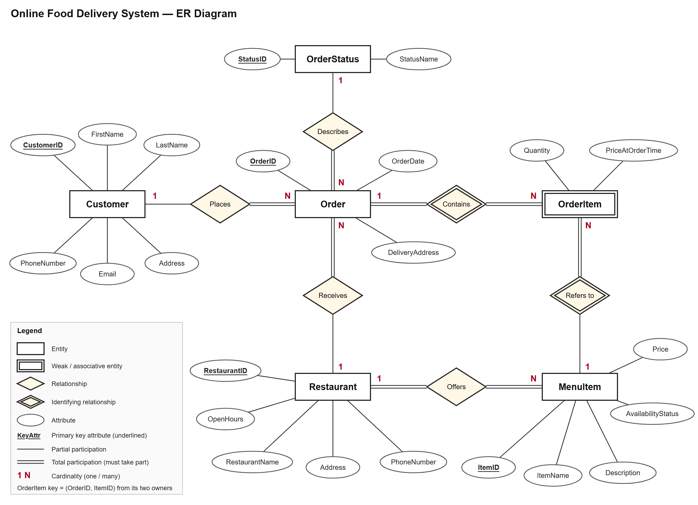

# Database Design — Online Food Delivery System (Team 12)

> DRAFT — review and rewrite in your own words before putting it in `team12.pdf`.

---

## 0. Final ER Diagram



Source file: [`er-diagram.svg`](er-diagram.svg) (Chen notation; edit it, then re-export the PNG).

---

## 1. Final Relational Schema

PK = primary key, FK = foreign key, UQ = unique.

```
CUSTOMER     (CustomerID PK, FirstName, LastName, PhoneNumber, Email UQ, Address)
RESTAURANT   (RestaurantID PK, RestaurantName, PhoneNumber, OpenHours, Address)
ORDER_STATUS (StatusID PK, StatusName UQ)
MENU_ITEM    (ItemID PK, RestaurantID FK, ItemName, Description, Price, AvailabilityStatus)
             UQ (RestaurantID, ItemName)
ORDERS       (OrderID PK, CustomerID FK, RestaurantID FK, StatusID FK, OrderDate, DeliveryAddress)
ORDER_ITEM   (OrderID PK/FK, ItemID PK/FK, Quantity, PriceAtOrderTime)
```

### Referential integrity

| Foreign key | References | ON UPDATE | ON DELETE |
|---|---|---|---|
| MENU_ITEM.RestaurantID | RESTAURANT.RestaurantID | CASCADE | RESTRICT |
| ORDERS.CustomerID | CUSTOMER.CustomerID | CASCADE | RESTRICT |
| ORDERS.RestaurantID | RESTAURANT.RestaurantID | CASCADE | RESTRICT |
| ORDERS.StatusID | ORDER_STATUS.StatusID | CASCADE | RESTRICT |
| ORDER_ITEM.OrderID | ORDERS.OrderID | CASCADE | CASCADE |
| ORDER_ITEM.ItemID | MENU_ITEM.ItemID | CASCADE | RESTRICT |

RESTRICT protects order history (a customer, restaurant, or menu item that appears
in an order cannot be deleted). CASCADE from ORDERS to ORDER_ITEM means an order's
line items are removed together with the order.

### Other constraints

| Table | Constraint | Purpose |
|---|---|---|
| All | NOT NULL on all required columns (only `MENU_ITEM.Description` is optional) | No missing required data |
| All | `AUTO_INCREMENT` integer surrogate keys | MySQL generates unique IDs |
| CUSTOMER | `UNIQUE (Email)`, `CHECK (Email LIKE '%_@_%._%')` | One account per email; basic format check |
| CUSTOMER, RESTAURANT, MENU_ITEM | `CHECK (TRIM(name) <> '')` | Names cannot be blank spaces |
| ORDER_STATUS | `UNIQUE (StatusName)` | No duplicate statuses |
| MENU_ITEM | `UNIQUE (RestaurantID, ItemName)` | A restaurant cannot list the same item twice |
| MENU_ITEM | `CHECK (Price >= 0)`, `DECIMAL(8,2)` | No negative prices; exact money arithmetic |
| MENU_ITEM | `AvailabilityStatus BOOLEAN NOT NULL DEFAULT TRUE` | New items are available by default |
| ORDERS | `OrderDate DATETIME NOT NULL DEFAULT CURRENT_TIMESTAMP` | Records date and time automatically |
| ORDER_ITEM | `CHECK (Quantity > 0)`, `CHECK (PriceAtOrderTime >= 0)` | No zero/negative quantities or prices |

### Business rules enforced by the application (not by the schema)

- **One restaurant per order:** every `ORDER_ITEM.ItemID` must belong to the same
  restaurant as `ORDERS.RestaurantID`. The backend checks this inside the
  place-order transaction before inserting.
- **Each restaurant offers at least one menu item:** a minimum-participation rule
  that foreign keys cannot express. Ensured by the sample data and application.
- **Each order contains at least one item:** the place-order form and backend
  reject an empty order; the order and its items are inserted in one transaction.

---

## 2. Changes from the Previous Design

| # | Previous design | Updated design | Reason |
|---|---|---|---|
| 1 | `ORDER_ITEM.Subtotal` stored | Removed; computed as `Quantity * PriceAtOrderTime` in SQL | Derived attribute. The dependency `{Quantity, PriceAtOrderTime} → Subtotal` is transitive and violates 3NF; storing it also risks inconsistency |
| 2 | `ORDERS.TotalAmount` stored | Removed; computed with `SUM(Quantity * PriceAtOrderTime) … GROUP BY OrderID` | Derived from other rows; storing it can drift out of sync with ORDER_ITEM |
| 3 | `OrderStatus` free-text attribute | New lookup table `ORDER_STATUS`; `ORDERS.StatusID` FK | Restricts status to valid values; status names stored once; the web form loads the dropdown from this table |
| 4 | Requirements listed one `Name` | `FirstName`, `LastName` | Atomic attributes (1NF); allows search/sort by last name |
| 5 | `OpeningHour` | `OpenHours` (text such as `Mon-Sun 10:00-22:00`) | Consistent naming; hours vary by day so a single time is not enough |
| 6 | `OrderDate` | `DATETIME` with default `CURRENT_TIMESTAMP` | Delivery orders need time, not only date |
| 7 | No data types / constraints | Data types, NOT NULL, UNIQUE, CHECK, and FK actions defined | Entity and referential integrity required by the assignment |
| 8 | Order N:N MenuItem shown alongside OrderItem | M:N resolved only through the associative table `ORDER_ITEM` (two 1:N relationships) | Removes the duplicate relationship in the diagram |

**ER diagram updates needed:** add entity `ORDER_STATUS` (StatusID, StatusName) with
relationship *ORDER_STATUS 1 — N ORDERS*; remove attributes `Subtotal` and
`TotalAmount`; replace the `OrderStatus` attribute on Order with that relationship.

---

## 3. Functional Dependencies

| Table | Functional dependencies | Candidate keys |
|---|---|---|
| CUSTOMER | `CustomerID → FirstName, LastName, PhoneNumber, Email, Address`<br>`Email → CustomerID, FirstName, LastName, PhoneNumber, Address` | CustomerID, Email |
| RESTAURANT | `RestaurantID → RestaurantName, PhoneNumber, OpenHours, Address` | RestaurantID |
| ORDER_STATUS | `StatusID → StatusName`<br>`StatusName → StatusID` | StatusID, StatusName |
| MENU_ITEM | `ItemID → RestaurantID, ItemName, Description, Price, AvailabilityStatus`<br>`{RestaurantID, ItemName} → ItemID, Description, Price, AvailabilityStatus` | ItemID, {RestaurantID, ItemName} |
| ORDERS | `OrderID → CustomerID, RestaurantID, StatusID, OrderDate, DeliveryAddress` | OrderID |
| ORDER_ITEM | `{OrderID, ItemID} → Quantity, PriceAtOrderTime` | {OrderID, ItemID} |

Dependencies that intentionally do **not** hold:
- `RestaurantName ↛ RestaurantID` — two branches of a chain may share a name.
- `PhoneNumber ↛ CustomerID` — family members may share a phone.
- `CustomerID ↛ DeliveryAddress` — a customer can deliver to work, a friend, etc., so DeliveryAddress depends on the order, not the customer.
- `ItemID ↛ PriceAtOrderTime` — the menu price changes over time; the price paid depends on the specific order *and* item.

---

## 4. Normalization to 3NF

**1NF.** Every column holds one atomic value (e.g. FirstName/LastName instead of
a combined name; one row per ordered item instead of a list of items in ORDERS).
Every table has a primary key, and there are no repeating groups.

**2NF.** Only ORDER_ITEM has a composite key `{OrderID, ItemID}`. Its non-key
attributes depend on the whole key:
- `Quantity` — how many of *this item* in *this order*.
- `PriceAtOrderTime` — the price of *this item* when *this order* was placed.
  It does not depend on ItemID alone, because `MENU_ITEM.Price` can change later.
  This is historical data, not a copy of `MENU_ITEM.Price`.

`ItemName` and the current `Price` stay in MENU_ITEM, so there is no partial
dependency on ItemID alone. All other tables have single-column primary keys,
so they are automatically in 2NF. (MENU_ITEM's second candidate key
`{RestaurantID, ItemName}` has no attribute depending on only part of it.)

**3NF.** No non-key attribute depends on another non-key attribute:
- The only transitive dependency in the earlier design was
  `{OrderID, ItemID} → {Quantity, PriceAtOrderTime} → Subtotal`. Removing
  `Subtotal` (and the aggregate `TotalAmount`) eliminates it.
- Order status names are stored in ORDER_STATUS; ORDERS stores only `StatusID`.
  Storing the name in ORDERS would be repeated text for every order.
- Restaurant and customer details are stored only in their own tables; ORDERS
  holds only their IDs.
- In CUSTOMER, `Email → …` does not violate 3NF because Email is a candidate key.
  The same applies to `StatusName` and `{RestaurantID, ItemName}`.

Every determinant in every table is a candidate key, so the schema also satisfies
**BCNF**, which is stricter than 3NF.

**Design note on `ORDERS.RestaurantID`.** It is kept even though the restaurant
can be found through the order's items, because (1) the order row is created
before its items, (2) it states the "one restaurant per order" rule directly, and
(3) it allows per-restaurant reports without joining through ORDER_ITEM.
